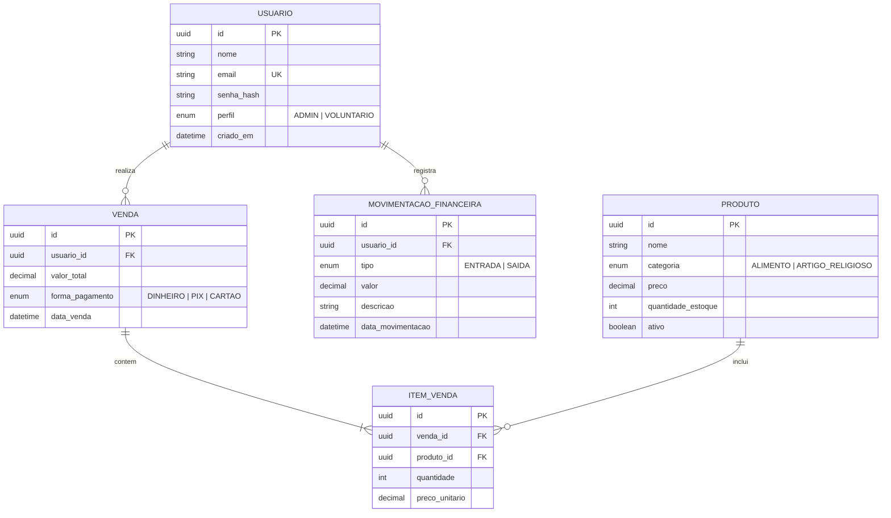

# AgnusGestao - Sistema de Gestão do Grupo de Oração Agnus Dei

Sistema de gerenciamento para controle de caixa, estoque e vendas do Grupo de Oração Agnus Dei, pertencente à Paróquia São Vicente Ferrer (Formiga - MG).

## 1. Tema e Propósito

O **AgnusGestao** é um sistema de gerenciamento destinado ao controle financeiro do grupo de oração, incluindo a gestão do catálogo e a venda de produtos (alimentos, bebidas, terços, camisetas e artigos religiosos) comercializados nos encontros, além do controle das entradas e saídas de recursos do caixa.

## 2. Perfis de Acesso e Permissões

- **ADMIN (Coordenador):** acesso completo ao sistema. Pode gerenciar voluntários, cadastrar e alterar produtos, registrar entradas e saídas financeiras e emitir relatórios.
- **VOLUNTARIO (Membro Servidor):** acesso restrito à consulta do catálogo de produtos e ao registro de vendas realizadas durante os encontros.

## 3. Entidades de Negócio

1. **Usuario:** cadastro de membros, voluntários e coordenadores, utilizado para autenticação JWT e controle de permissões.
2. **Produto:** cadastro dos itens comercializados nos encontros, divididos em alimentos e artigos religiosos.
3. **Venda:** registro das transações comerciais, incluindo valor total, voluntário responsável e forma de pagamento.
4. **MovimentacaoFinanceira:** controle do caixa do grupo, registrando entradas e despesas ou saídas, com descrição e data.

## 4. Diagrama de Entidade-Relacionamento (DER)

## 5. Semana 2 — Estruturação do Backend e Banco de Dados

Nesta etapa, foi estruturada a base técnica do backend do **Agnus Gestão**, configurando o servidor de aplicação, o banco de dados relacional e a containerização do ambiente.

### 5.1. Tecnologias Utilizadas

- **Node.js & Express:** Configuração do servidor Web e gerenciamento das rotas HTTP.
- **PostgreSQL & Sequelize ORM:** Banco de dados relacional e mapeamento objeto-relacional (ORM) para modelagem das entidades.
- **Docker & Docker Compose:** Containerização da aplicação e do banco de dados para padronização do ambiente de desenvolvimento.
- **dotenv:** Gerenciamento seguro de variáveis de ambiente.

### 5.2. Arquitetura do Projeto

A aplicação foi organizada seguindo o padrão de arquitetura em camadas:

- `src/config/`: Configuração de conexão com o PostgreSQL via Sequelize.
- `src/models/`: Modelos das entidades do banco de dados e suas associações.
- `src/controllers/`: Regras de fluxo e manipulação das requisições/respostas.
- `src/routes/`: Mapeamento e declaração dos endpoints da API.
- `src/middlewares/`: Tratamento centralizado de erros e interceptação de requisições.
- `src/app.js`: Ponto de entrada para inicialização da aplicação Express.

### 5.3. Modelagem de Entidades e Relacionamentos

Os modelos foram mapeados via Sequelize com tipos de dados, chaves primárias UUID e restrições:

- **Usuario:** Identificador único, nome, e-mail único, hash da senha e perfil de acesso (`ADMIN` ou `VOLUNTARIO`).
- **Produto:** Identificador único, nome, categoria (`ALIMENTO` ou `ARTIGO_RELIGIOSO`), preço unitário, quantidade em estoque e status (`ativo`).
- **Venda:** Identificador único, chave estrangeira do usuário responsável, valor total, forma de pagamento (`DINHEIRO`, `PIX` ou `CARTAO`) e data do registro.
- **ItemVenda:** Tabela associativa entre Venda e Produto, armazenando quantidade, preço unitário e subtotal.
- **MovimentacaoFinanceira:** Registro de caixa vinculado à venda e ao usuário, contendo tipo (`ENTRADA` ou `SAIDA`), valor e descrição.

As relações (1:N e N:M) foram consolidadas no arquivo `src/models/index.js`.

---

## 6. Semana 3 — Autenticação, Segurança (RBAC) e Recuperação de Senha

Nesta etapa, foram implementados os mecanismos de segurança e controle de acesso da API:

- **Autenticação JWT (JSON Web Token):** Emissão de tokens assinados para controle de sessão do usuário.
- **Criptografia de Senhas:** Hashing de senhas utilizando a biblioteca `bcryptjs`.
- **Controle de Acesso por Perfil (RBAC):** Middleware para restrição de rotas conforme a função do usuário (`ADMIN` vs. `VOLUNTARIO`).
- **Recuperação de Senha:** Emissão de tokens temporários com tempo de expiração para redefinição segura de credenciais.
- **Ambiente Dockerizado com Seed:** Inicialização automatizada do banco PostgreSQL via Docker com criação do usuário administrador padrão (`admin@agnus.com` / `123456`).

### Endpoints do Módulo de Autenticação (`/auth`)

- `POST /auth/login` — Autentica o usuário e retorna o Token JWT.
- `POST /auth/forgot-password` — Solicita a redefinição de senha e gera o token de recuperação.
- `POST /auth/reset-password` — Redefine a senha utilizando o token temporário.

---

## 7. Semana 4 — Entidades Centrais, Transações Atômicas e Regras de Negócio

Nesta etapa, foi finalizado o fluxo comercial principal do sistema, conectando o catálogo de **Produtos**, o registro de **Vendas** e a gerência de **Movimentações Financeiras** sob regras estritas de controle de estoque e transações de banco de dados.

### 7.1. Destaques da Implementação

- **CRUD Completo de Produtos:** Operações para criação, consulta, atualização e remoção/desativação de itens no catálogo.
- **Transações Atômicas (`sequelize.transaction`):** O registro da venda, a gravação dos itens vendidos, o abatimento no estoque e o lançamento da movimentação financeira no caixa são executados em bloco único. Caso ocorra falha em qualquer etapa, a transação sofre `rollback` automático.
- **Validação e Controle Automático de Estoque:** Impedimento de vendas com quantidade zerada (`<= 0`) ou superior ao saldo disponível no banco, retornando `400 Bad Request`.
- **Proteção de Rotas (RBAC):** Manutenção de produtos restrita a perfil `ADMIN`; consulta de produtos e lançamento de vendas liberados para `ADMIN` e `VOLUNTARIO`.

---

### 7.2. Mapeamento de Endpoints (Semana 4)

#### 🛍️ Módulo de Produtos (`/produtos`)

| Método | Endpoint | Permissão | Descrição |
| :--- | :--- | :--- | :--- |
| `GET` | `/produtos` | Autenticado | Lista todos os produtos do catálogo |
| `GET` | `/produtos/:id` | Autenticado | Exibe os detalhes de um produto específico por ID |
| `POST` | `/produtos` | `ADMIN` | Cadastra um novo produto |
| `PUT` | `/produtos/:id` | `ADMIN` | Atualiza os dados de um produto |
| `DELETE` | `/produtos/:id` | `ADMIN` | Remove ou desativa um produto |

#### 💰 Módulo de Vendas (`/vendas`)

| Método | Endpoint | Permissão | Descrição |
| :--- | :--- | :--- | :--- |
| `POST` | `/vendas` | Autenticado | Registra uma nova venda com baixa de estoque e lançamento financeiro |
| `GET` | `/vendas` | Autenticado | Lista o histórico de vendas (filtrado por usuário se `VOLUNTARIO`) |
| `GET` | `/vendas/:id` | Autenticado | Consulta os detalhes de uma venda e seus itens por ID |

---

### 7.3. Validação dos Testes (Postman & Docker)

As rotas e regras de negócio foram validadas no Postman com a aplicação rodando em ambiente Docker:

1. **Cadastrar Produto (`POST /produtos`):** Confirmação de criação (`201 Created`) com geração de UUID.
2. **Consultar Estoque (`GET /produtos`):** Verificação do saldo inicial do produto cadastrado.
3. **Realizar Venda (`POST /vendas`):** Confirmação de venda efetuada (`201 Created`), cálculo automático do subtotal e baixa imediata no estoque.
4. **Validação de Estoque Insuficiente:** Tentativa de venda sem saldo gera erro formatado (`400 Bad Request`).
5. **Detalhar Venda (`GET /vendas/:id`):** Retorno estruturado (`200 OK`) com dados da venda, vendedor responsável e itens associados.