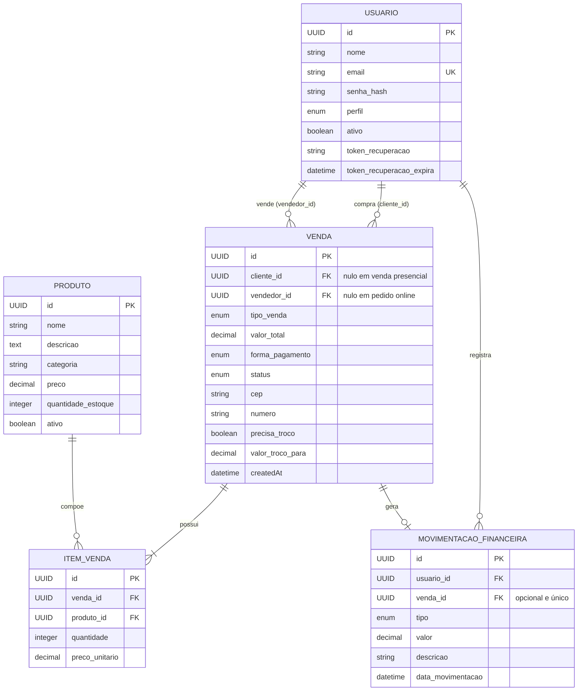

# AgnusGestao — API (Back-End)

API REST do sistema de gestão do **Grupo de Oração Agnus Dei** (Paróquia São Vicente Ferrer, Formiga — MG). Centraliza produtos, estoque, vendas (presenciais e online) e o caixa do grupo. Feita em Node.js + Express + PostgreSQL para o Desafio Back-End 2026/2; consumida pelo front-end React (repositório `agnus-frontend`, porta 5180).

## Sumário

1. [Apresentação e perfis](#1-apresentação-e-perfis)
2. [Como executar](#2-como-executar)
3. [Variáveis de ambiente](#3-variáveis-de-ambiente)
4. [Entidades e DER](#4-entidades-e-der)
5. [Regras de negócio e permissões](#5-regras-de-negócio-e-permissões)
6. [Endpoints](#6-endpoints)
7. [API externa: ViaCEP](#7-api-externa-viacep)
8. [Testes e documentação interativa](#8-testes-e-documentação-interativa)
9. [Tecnologias e arquitetura](#9-tecnologias-e-arquitetura)

---

## 1. Apresentação e perfis

O sistema substitui o controle manual de vendas e caixa do grupo: o administrador cadastra produtos e acompanha o caixa; voluntários registram vendas nos encontros; clientes compram artigos religiosos pela loja online, com entrega.

| Perfil       | Papel                                                           |
| ------------ | --------------------------------------------------------------- |
| `ADMIN`      | Gestão completa: produtos, voluntários, vendas, pedidos e caixa |
| `VOLUNTARIO` | Registra vendas presenciais (lanchonete e artigos religiosos)   |
| `CLIENTE`    | Compra artigos religiosos online e consulta as próprias compras |

---

## 2. Como executar

**Pré-requisitos:** Docker e Docker Compose. (Sem Docker: Node.js 20+, npm e PostgreSQL.) Postman é opcional, para os testes.

### Com Docker (recomendado)

```bash
git clone URL_DO_REPOSITORIO
cd agnus-backend
cp .env.example .env            # PowerShell: Copy-Item .env.example .env
# edite o .env: no mínimo DB_PASSWORD, JWT_SECRET, ADMIN_PASSWORD (veja a seção 3)
docker compose up --build
```

Sobem o PostgreSQL e a API. As tabelas são criadas automaticamente e o ADMIN inicial é criado na primeira execução (`ADMIN_EMAIL` / `ADMIN_PASSWORD`). Não há migrations nem seed de produtos: cadastre-os pelo ADMIN.

Verifique:

```bash
curl http://localhost:3002/          # {"nome":"AgnusGestao API","status":"ok",...}
curl http://localhost:3002/health    # {"status":"ok","database":"ok"}
```

| Serviço                    | Endereço                                      |
| -------------------------- | --------------------------------------------- |
| API                        | `http://localhost:3002` (rotas em `/api/...`) |
| Especificação OpenAPI      | `http://localhost:3002/api/docs`              |
| PostgreSQL (do host)       | `localhost:5433`                              |
| Front-end liberado no CORS | `http://localhost:5180`                       |

Encerrar:

```bash
docker compose down        # mantém os dados
docker compose down -v     # APAGA o volume do PostgreSQL
```

### Sem Docker

Com PostgreSQL rodando e o banco criado, ajuste no `.env` `DB_HOST=localhost` e `DB_PORT` para a porta do seu PostgreSQL (`5433` se estiver usando o contêiner `db` do compose), depois:

```bash
npm install
npm run dev      # nodemon; use "npm start" para execução simples
```

### Serviços externos

- **ViaCEP:** nenhum cadastro; só precisa de internet (seção 7).
- **SMTP (recuperação de senha):** ⚠️ **o servidor SMTP não está funcionando no momento.** Por isso a recuperação de senha por e-mail **não opera**: ao solicitar, o usuário recebe a mensagem _"Não foi possível enviar o e-mail de recuperação. Verifique o servidor SMTP."_ e nenhum e-mail é entregue. O restante da API funciona normalmente. Para redefinir uma senha enquanto isso, o ADMIN usa o [procedimento alternativo](#procedimento-alternativo-de-redefinição-de-senha).

#### Procedimento alternativo de redefinição de senha

Logado como ADMIN, altere a senha do usuário pelo ID (obtido em `GET /usuarios`):

```bash
curl -X PUT http://localhost:3002/api/usuarios/ID_DO_USUARIO \
  -H "Authorization: Bearer TOKEN_DO_ADMIN" \
  -H "Content-Type: application/json" \
  -d '{ "senha": "novaSenha123" }'
```

Para voluntários, o front-end também permite isso em **Voluntários → editar**. Quando o SMTP for corrigido (variáveis `MAIL_*` válidas, seção 3), o fluxo por e-mail volta a funcionar sem mudança de código.

---

## 3. Variáveis de ambiente

Copie `.env.example` para `.env` e preencha. O `.env` está no `.gitignore`: **nunca o versione** nem o inclua em entregas.

| Variável                                  |           Obrigatória            | Como preencher                                                                                                             |
| ----------------------------------------- | :------------------------------: | -------------------------------------------------------------------------------------------------------------------------- |
| `PORT`                                    |               não                | `3002` (o compose já força esse valor)                                                                                     |
| `FRONTEND_ORIGIN`                         |               sim                | Origem liberada no CORS: `http://localhost:5180`                                                                           |
| `FRONTEND_URL`                            |               sim                | URL do front para o link do e-mail: `http://localhost:5180`                                                                |
| `DB_HOST` / `DB_PORT`                     |               sim                | Docker: `db` / `5432`. Fora do Docker: `localhost` / porta do seu PostgreSQL                                               |
| `DB_USER` / `DB_PASSWORD` / `DB_NAME`     |               sim                | Escolha usuário e senha; nome padrão `agnus_gestao`                                                                        |
| `JWT_SECRET`                              |               sim                | Mínimo 32 caracteres. Gere com `node -e "console.log(require('crypto').randomBytes(48).toString('hex'))"`                  |
| `JWT_EXPIRES_IN`                          |               não                | Ex.: `1d`, `8h` (padrão `7d`)                                                                                              |
| `ADMIN_NAME` / `ADMIN_EMAIL`              |               não                | Dados do ADMIN inicial (padrão `Administrador` / `admin@agnus.com`)                                                        |
| `ADMIN_PASSWORD`                          |               sim                | Mínimo 8 caracteres; é o login do ADMIN                                                                                    |
| `MAIL_HOST` / `MAIL_PORT` / `MAIL_SECURE` | só p/ e-mail (hoje indisponível) | Gmail: `smtp.gmail.com` / `587` / `false`                                                                                  |
| `MAIL_USER` / `MAIL_PASS` / `MAIL_FROM`   | só p/ e-mail (hoje indisponível) | Gmail: ative a verificação em 2 etapas e gere uma **senha de app** em `myaccount.google.com/apppasswords` para `MAIL_PASS` |

A API **não inicia** se `JWT_SECRET` tiver menos de 32 caracteres ou `ADMIN_PASSWORD` menos de 8.

---

## 4. Entidades e DER

| Entidade                   | Descrição                         | Campos principais                                                                                                                                                                                                                                                                   |
| -------------------------- | --------------------------------- | ----------------------------------------------------------------------------------------------------------------------------------------------------------------------------------------------------------------------------------------------------------------------------------- |
| **Usuario**                | Contas do sistema                 | `id` (UUID), `nome`, `email` (único), `senha_hash`, `perfil` (`ADMIN`/`VOLUNTARIO`/`CLIENTE`), `ativo`, `token_recuperacao` e `token_recuperacao_expira`                                                                                                                            |
| **Produto**                | Itens à venda                     | `id`, `nome`, `descricao`, `categoria`, `preco`, `quantidade_estoque`, `ativo`                                                                                                                                                                                                      |
| **Venda**                  | Venda presencial ou pedido online | `id`, `cliente_id`, `vendedor_id`, `tipo_venda` (`ONLINE`/`PRESENCIAL`), `valor_total`, `forma_pagamento` (`PIX`/`DINHEIRO`), `status`, dados de entrega (`cep`, `logradouro`, `bairro`, `cidade`, `uf`, `numero`, `complemento`), `precisa_troco`, `valor_troco_para`, `createdAt` |
| **ItemVenda**              | Produtos de cada venda            | `id`, `venda_id`, `produto_id`, `quantidade`, `preco_unitario` (preço no momento da venda)                                                                                                                                                                                          |
| **MovimentacaoFinanceira** | Entradas e saídas do caixa        | `id`, `usuario_id`, `venda_id` (opcional, único), `tipo` (`ENTRADA`/`SAIDA`), `valor`, `descricao`, `data_movimentacao`                                                                                                                                                             |



(O diagrama omite os demais campos de endereço da `Venda`, listados na tabela.)

---

## 5. Regras de negócio e permissões

### Permissões por perfil

| Funcionalidade                                      | Público | CLIENTE | VOLUNTARIO | ADMIN |
| --------------------------------------------------- | :-----: | :-----: | :--------: | :---: |
| Consultar produtos ativos e CEP                     |   Sim   |   Sim   |    Sim     |  Sim  |
| Cadastrar-se (cria `CLIENTE`)                       |   Sim   |    —    |     —      |   —   |
| Cadastrar, editar e desativar produtos              |   Não   |   Não   |    Não     |  Sim  |
| Registrar venda presencial                          |   Não   |   Não   |    Sim     |  Sim  |
| Fazer pedido online e ver as próprias compras       |   Não   |   Sim   |    Não     |  Não  |
| Listar, consultar, alterar status e cancelar vendas |   Não   |   Não   |    Não     |  Sim  |
| Gerenciar voluntários (criar, editar, desativar)    |   Não   |   Não   |    Não     |  Sim  |
| Caixa: movimentações, resumo e exportação           |   Não   |   Não   |    Não     |  Sim  |

### Contas

- O cadastro público (`/auth/register`) cria **sempre** `CLIENTE`; ninguém se cadastra como ADMIN.
- O ADMIN inicial vem do `.env`. Voluntários são criados pelo ADMIN em `POST /usuarios`; o perfil não pode ser alterado depois.
- Usuário desativado não faz login, e seu token deixa de valer. O ADMIN não pode desativar a própria conta.

### Produtos e estoque

- Só produtos **ativos** aparecem nas consultas e podem ser vendidos. `DELETE /produtos/:id` apenas desativa, preservando o histórico de vendas.
- Venda com quantidade acima do estoque é recusada; o estoque é baixado ao registrar a venda.
- A `categoria` define onde o produto pode ser vendido. É **artigo religioso** a categoria que contém `RELIG`, `LOJA`, `LOJINHA`, `TERCO`, `BIBLIA`, `CRUCIFIXO`, `IMAGEM` ou `SANTO` (sem diferenciar maiúsculas ou acentos). Sem categoria, o produto é criado como `ARTIGO_RELIGIOSO`. Use, por exemplo, `LANCHONETE` para itens de lanchonete.

### Vendas

- **Presencial** (`VOLUNTARIO` ou `ADMIN`): aceita qualquer produto ativo; pagamento `DINHEIRO` (padrão) ou `PIX`; nasce `CONCLUIDO` e **gera uma entrada no caixa**.
- **Online** (`CLIENTE`): somente artigos religiosos (a API recusa lanchonete com 403); exige CEP válido e número; pagamento **na entrega** (`PIX` ou `DINHEIRO`); nasce `AGUARDANDO_ENTREGA` e **não gera movimentação no caixa**.
- Troco: só com `DINHEIRO`; informe `precisa_troco: true` e `troco_para` (maior ou igual ao total do pedido).
- Status permitidos na alteração: `AGUARDANDO_RETIRADA`, `AGUARDANDO_ENTREGA`, `CONCLUIDO`, `CANCELADO`. Venda cancelada não reabre.
- **Cancelar** devolve os itens ao estoque e remove a entrada de caixa vinculada à venda.

### Caixa

- O ADMIN registra entradas (valores recebidos) e saídas (despesas) manuais.
- Só movimentações **manuais** podem ser excluídas. As geradas por venda são estornadas cancelando a venda (excluí-las retorna 409).
- O resumo calcula entradas, saídas e saldo a partir de todas as movimentações.

---

## 6. Endpoints

- **URL-base:** `http://localhost:3002/api` (as rotas também respondem sem o prefixo `/api`).
- Corpo e respostas em **JSON**. Valores `DECIMAL` (preços, totais) são retornados como texto, ex.: `"25.00"`, quando vêm do banco.
- Rotas protegidas exigem `Authorization: Bearer <token>` (token do login).
- Erros seguem sempre `{ "mensagem": "..." }` (seção 6.8).
- Colunas **Obrigatórios**/**Opcionais** listam os campos do corpo JSON.

### 6.1 Autenticação

| Método e caminho             | Permissão | Obrigatórios                               | Opcionais |
| ---------------------------- | --------- | ------------------------------------------ | --------- |
| `POST /auth/login`           | Público   | `email`, `senha`                           | —         |
| `POST /auth/register`        | Público   | `nome`, `email` (válido), `senha` (mín. 8) | —         |
| `POST /auth/forgot-password` | Público   | `email`                                    | —         |
| `POST /auth/reset-password`  | Público   | `token`, `nova_senha` (mín. 8)             | —         |

`POST /auth/login`

```json
{ "email": "admin@agnus.com", "senha": "sua_senha" }
```

```json
// 200
{
  "mensagem": "Login realizado com sucesso!",
  "token": "eyJhbGciOi...",
  "usuario": {
    "id": "b1c2...",
    "nome": "Administrador",
    "email": "admin@agnus.com",
    "perfil": "ADMIN"
  }
}
```

Erros: `400` (campos ausentes), `401` (`Credenciais inválidas.`, inclusive usuário desativado).

`POST /auth/register`

```json
{ "nome": "Maria Souza", "email": "maria@exemplo.com", "senha": "senha1234" }
```

```json
// 201
{
  "mensagem": "Usuário cadastrado com sucesso!",
  "usuario": {
    "id": "...",
    "nome": "Maria Souza",
    "email": "maria@exemplo.com",
    "perfil": "CLIENTE"
  }
}
```

Erros: `400` (dados inválidos), `409` (`Este e-mail já está em uso.`).

`POST /auth/forgot-password` e `POST /auth/reset-password`

> ⚠️ **Indisponível no momento:** o servidor SMTP não está funcionando, então o e-mail com o token não é enviado e o fluxo não pode ser concluído (veja a [seção 2](#serviços-externos)). Os dois endpoints estão implementados e abaixo está o contrato esperado quando o SMTP voltar.

```json
{ "email": "maria@exemplo.com" }
```

```json
// 200 esperado, com SMTP funcionando (mesma resposta exista ou não o e-mail)
{
  "mensagem": "Se o e-mail estiver cadastrado, você receberá as instruções para redefinição de senha."
}
```

Com o SMTP fora do ar, o usuário recebe _"Não foi possível enviar o e-mail de recuperação. Verifique o servidor SMTP."_
O e-mail traz o link `FRONTEND_URL/redefinir-senha?token=...`, válido por 30 minutos e de uso único. Com o token do link:

```json
{ "token": "TOKEN_DO_LINK", "nova_senha": "novaSenha123" }
```

```json
// 200
{ "mensagem": "Senha redefinida com sucesso!" }
```

Erro: `400` (`Token inválido ou expirado.`).

### 6.2 Produtos

| Método e caminho       | Permissão | Obrigatórios          | Opcionais                                                                                                       |
| ---------------------- | --------- | --------------------- | --------------------------------------------------------------------------------------------------------------- |
| `GET /produtos`        | Público   | —                     | —                                                                                                               |
| `GET /produtos/:id`    | Público   | —                     | —                                                                                                               |
| `POST /produtos`       | ADMIN     | `nome`, `preco` (> 0) | `descricao`, `categoria` (padrão `ARTIGO_RELIGIOSO`), `quantidade_estoque` ou `estoque` (inteiro ≥ 0, padrão 0) |
| `PUT /produtos/:id`    | ADMIN     | —                     | `nome`, `descricao`, `preco`, `categoria`, `quantidade_estoque` ou `estoque` (envie só o que mudar)             |
| `DELETE /produtos/:id` | ADMIN     | —                     | —                                                                                                               |

`POST /produtos`

```json
{
  "nome": "Terço",
  "descricao": "Terço religioso",
  "preco": 25.0,
  "categoria": "ARTIGO_RELIGIOSO",
  "quantidade_estoque": 20
}
```

```json
// 201
{
  "id": "3f2a...",
  "nome": "Terço",
  "descricao": "Terço religioso",
  "categoria": "ARTIGO_RELIGIOSO",
  "preco": 25,
  "quantidade_estoque": 20,
  "ativo": true
}
```

`GET /produtos` → `200` com array desse formato (só ativos, ordenados por nome). `DELETE` → `200 { "mensagem": "Produto desativado com sucesso." }`. Erros: `400` (dados inválidos), `401`/`403` (sem token/perfil), `404` (`Produto não encontrado.`).

### 6.3 Vendas

| Método e caminho             | Permissão         | Obrigatórios                                        | Opcionais                                                                                      |
| ---------------------------- | ----------------- | --------------------------------------------------- | ---------------------------------------------------------------------------------------------- |
| `POST /vendas/presencial`    | VOLUNTARIO, ADMIN | `itens`                                             | `forma_pagamento` (`DINHEIRO` padrão, `PIX`)                                                   |
| `POST /vendas/online`        | CLIENTE           | `itens`, `cep`, `numero`, `forma_pagamento_entrega` | `complemento`, `precisa_troco` (padrão `false`), `troco_para` (obrigatório se `precisa_troco`) |
| `GET /vendas/minhas-compras` | CLIENTE           | —                                                   | —                                                                                              |
| `GET /vendas`                | ADMIN             | —                                                   | —                                                                                              |
| `GET /vendas/:id`            | ADMIN             | —                                                   | —                                                                                              |
| `PATCH /vendas/:id/status`   | ADMIN             | `status`                                            | —                                                                                              |
| `DELETE /vendas/:id`         | ADMIN             | —                                                   | —                                                                                              |

`itens` é uma lista de `{ "produto_id": "UUID", "quantidade": inteiro > 0 }`.

`POST /vendas/presencial`

```json
{
  "itens": [{ "produto_id": "3f2a...", "quantidade": 2 }],
  "forma_pagamento": "DINHEIRO"
}
```

```json
// 201
{
  "mensagem": "Venda presencial concluída com sucesso!",
  "venda": {
    "id": "9d1e...",
    "tipo_venda": "PRESENCIAL",
    "valor_total": 50,
    "forma_pagamento": "DINHEIRO",
    "status": "CONCLUIDO",
    "cliente_id": null,
    "vendedor_id": "b1c2...",
    "createdAt": "2026-11-08T18:00:00.000Z"
  }
}
```

`POST /vendas/online`

```json
{
  "itens": [{ "produto_id": "3f2a...", "quantidade": 1 }],
  "cep": "35570000",
  "numero": "100",
  "complemento": "Casa",
  "forma_pagamento_entrega": "DINHEIRO",
  "precisa_troco": true,
  "troco_para": 50
}
```

```json
// 201
{
  "mensagem": "Pedido realizado com sucesso! Seu pedido será entregue no endereço informado.",
  "venda": {
    "id": "c7a0...",
    "tipo_venda": "ONLINE",
    "valor_total": 25,
    "forma_pagamento": "DINHEIRO",
    "status": "AGUARDANDO_ENTREGA",
    "cep": "35570000",
    "logradouro": "...",
    "bairro": "...",
    "cidade": "Formiga",
    "uf": "MG",
    "numero": "100",
    "complemento": "Casa",
    "precisa_troco": true,
    "valor_troco_para": 50
  }
}
```

Erros comuns: `400` (item inválido, estoque insuficiente, CEP inválido ou inexistente, troco menor que o total), `403` (produto que não é artigo religioso).

`GET /vendas` e `GET /vendas/minhas-compras` → `200` com array de vendas, cada uma com `itens` (e `produto` em cada item); `GET /vendas` inclui também `cliente: { id, nome, email }`. `GET /vendas/:id` → `200` com uma venda, ou `404` (`Venda não encontrada.`).

`PATCH /vendas/:id/status`

```json
{ "status": "CONCLUIDO" }
```

```json
// 200
{
  "mensagem": "Status atualizado para CONCLUIDO.",
  "venda": { "id": "c7a0...", "status": "CONCLUIDO" }
}
```

Erros: `400` (status inválido ou venda cancelada), `404`. `DELETE /vendas/:id` cancela a venda (devolve estoque, remove a entrada de caixa) → `200 { "mensagem": "Status atualizado para CANCELADO.", "venda": {...} }`.

### 6.4 Usuários (voluntários)

Todas as rotas exigem `ADMIN`.

| Método e caminho                     | Obrigatórios                               | Opcionais                                             |
| ------------------------------------ | ------------------------------------------ | ----------------------------------------------------- |
| `GET /usuarios`                      | —                                          | —                                                     |
| `GET /usuarios/:id`                  | —                                          | —                                                     |
| `POST /usuarios` (cria `VOLUNTARIO`) | `nome`, `email` (válido), `senha` (mín. 8) | —                                                     |
| `PUT /usuarios/:id`                  | —                                          | `nome`, `email`, `senha` (mín. 8), `ativo` (booleano) |
| `DELETE /usuarios/:id` (desativa)    | —                                          | —                                                     |

`POST /usuarios`

```json
{ "nome": "João Voluntário", "email": "joao@exemplo.com", "senha": "senha1234" }
```

```json
// 201
{
  "mensagem": "Voluntário cadastrado.",
  "usuario": {
    "id": "...",
    "nome": "João Voluntário",
    "email": "joao@exemplo.com",
    "perfil": "VOLUNTARIO",
    "ativo": true,
    "criado_em": "2026-11-08T18:00:00.000Z"
  }
}
```

`GET /usuarios` → `200` com array de usuários (sem senha nem tokens). `PUT` → `200 { "mensagem": "Usuário atualizado.", "usuario": {...} }` (reativar: `{ "ativo": true }`). `DELETE` → `200 { "mensagem": "Usuário desativado com sucesso." }`. Erros: `400`, `404`, `409` (e-mail já cadastrado).

### 6.5 Caixa (movimentações)

Todas as rotas exigem `ADMIN`.

| Método e caminho              | Obrigatórios                                           | Opcionais                                  |
| ----------------------------- | ------------------------------------------------------ | ------------------------------------------ |
| `GET /movimentacoes`          | —                                                      | —                                          |
| `GET /movimentacoes/resumo`   | —                                                      | —                                          |
| `POST /movimentacoes`         | `tipo` (`ENTRADA`/`SAIDA`), `valor` (> 0), `descricao` | —                                          |
| `DELETE /movimentacoes/:id`   | —                                                      | —                                          |
| `GET /movimentacoes/exportar` | —                                                      | query `formato`: `excel` (padrão) ou `csv` |

`POST /movimentacoes`

```json
{ "tipo": "SAIDA", "valor": 50.0, "descricao": "Compra de materiais" }
```

```json
// 201
{
  "id": "5e8b...",
  "usuario_id": "b1c2...",
  "tipo": "SAIDA",
  "valor": 50,
  "descricao": "Compra de materiais",
  "data_movimentacao": "2026-11-08T18:00:00.000Z"
}
```

`GET /movimentacoes/resumo`

```json
// 200
{ "entradas": 170, "saidas": 50, "saldo": 120, "quantidade_movimentacoes": 3 }
```

`GET /movimentacoes` → `200` com array (mais recentes primeiro, com `usuario: { id, nome, email }`). `DELETE` → `200 { "mensagem": "Movimentação removida com sucesso." }`; `409` se a movimentação veio de uma venda; `404` se não existir. `exportar` devolve o arquivo `relatorio_caixa_agnus.xlsx` ou `.csv`.

### 6.6 CEP

| Método e caminho | Permissão | Obrigatórios                           |
| ---------------- | --------- | -------------------------------------- |
| `GET /cep/:cep`  | Público   | `cep` com 8 dígitos (com ou sem hífen) |

```json
// GET /api/cep/35570000 → 200
{
  "cep": "35570-000",
  "logradouro": "",
  "bairro": "",
  "cidade": "Formiga",
  "uf": "MG"
}
```

Erros: `400` (`Formato de CEP inválido.`), `404` (`CEP não encontrado.`).

### 6.7 Verificação

| Método e caminho | Descrição                                                          |
| ---------------- | ------------------------------------------------------------------ |
| `GET /`          | Status da API                                                      |
| `GET /health`    | `200` se API e banco respondem; `503` se o banco está indisponível |
| `GET /api/docs`  | Especificação OpenAPI em JSON                                      |

### 6.8 Erros

Formato: `{ "mensagem": "Texto do erro." }`. Sem detalhes técnicos, senhas ou tokens.

| Código    | Quando                                                                                   |
| --------- | ---------------------------------------------------------------------------------------- |
| 200 / 201 | Sucesso / registro criado                                                                |
| 400       | Dados inválidos ou regra de negócio violada (estoque, CEP, troco, status)                |
| 401       | Token ausente, inválido ou expirado; credenciais incorretas; usuário inativo             |
| 403       | Perfil sem permissão (`Acesso negado. Seu perfil (X) não tem permissão para esta ação.`) |
| 404       | Registro ou rota inexistente                                                             |
| 409       | Conflito: e-mail duplicado ou exclusão de movimentação de venda                          |
| 500       | Erro interno (`Erro interno do servidor.`)                                               |

---

## 7. API externa: ViaCEP

- **API:** [ViaCEP](https://viacep.com.br/) — pública, sem chave nem cadastro.
- **Finalidade:** na compra online, o cliente informa só o CEP; a API retorna logradouro, bairro, cidade e UF, que são gravados no pedido como endereço de entrega.
- **Onde é usada:** `GET /cep/:cep` (consulta isolada, usada pelo front para mostrar o endereço) e `POST /vendas/online` (valida o CEP e grava o endereço).
- **Requisito:** acesso à internet e ViaCEP disponível.

**Como verificar:**

```bash
curl http://localhost:3002/api/cep/35570000
```

Deve retornar cidade `Formiga` e UF `MG`. Um CEP inexistente (ex.: `00000000`) retorna `404`; um CEP com menos de 8 dígitos, `400`. No fluxo completo: faça login como `CLIENTE`, envie `POST /vendas/online` com `cep` válido e confira `logradouro`, `bairro`, `cidade` e `uf` na venda retornada.

---

## 8. Testes e documentação interativa

### OpenAPI (Swagger)

A especificação fica em `docs/openapi.json` (OpenAPI 3.0.3) e é servida em **`http://localhost:3002/api/docs`**. A API **não traz interface Swagger UI**; para navegar pela especificação, use uma destas opções:

1. Cole o JSON em [editor.swagger.io](https://editor.swagger.io) (File → Import file, ou cole o conteúdo).
2. Importe a URL `http://localhost:3002/api/docs` no Postman (Import → Link).

Para chamar rotas protegidas, use o token de `/auth/login` como Bearer. A seção 6 deste README é a referência completa; a especificação OpenAPI cobre as rotas principais.

### Postman

1. Importe `agnus_gestao_collection.json` (Import → arquivo).
2. Ajuste as variáveis da collection: `baseUrl` = `http://localhost:3002/api`, `serverUrl` = `http://localhost:3002`, `adminEmail` e `adminPassword` (os valores `ADMIN_EMAIL` e `ADMIN_PASSWORD` do seu `.env`).
3. Ordem de execução (tokens e IDs são guardados nas variáveis da collection):
   1. Pasta **1**: _Verificar API_, _Cadastrar CLIENTE_, _Login_ (ADMIN) e _Login CLIENTE_.
   2. Pasta **6**: _Cadastrar voluntário_ (o voluntário de teste ainda não existe no banco).
   3. Pasta **1**: _Login VOLUNTARIO_.
   4. Pastas **2** a **7**, em sequência.
4. As pastas incluem testes de bloqueio por perfil (RBAC). Os requests de recuperação de senha (pasta 1) **falham enquanto o SMTP estiver fora do ar**; ignore-os.

### Testes automatizados

```bash
npm test      # node --test; arquivos em test/
```

---

## 9. Tecnologias e arquitetura

| Tecnologia                     | Uso                                                         |
| ------------------------------ | ----------------------------------------------------------- |
| Node.js 20, Express 4          | API REST                                                    |
| PostgreSQL 15, Sequelize 6     | Banco e ORM (tabelas criadas com `sync` na inicialização)   |
| JWT (`jsonwebtoken`), bcryptjs | Autenticação e hash de senha                                |
| Nodemailer                     | E-mail de recuperação de senha (SMTP atualmente fora do ar) |
| Axios                          | Chamada ao ViaCEP                                           |
| ExcelJS                        | Exportação do relatório do caixa                            |
| Docker, Docker Compose         | Execução da API e do banco                                  |

Estrutura de `src/`:

```text
routes/               caminhos HTTP e permissões por rota
controllers/          requisição e resposta
application/usecases/ regras de negócio (vendas, produtos, usuários, caixa, autenticação)
domain/policies/      regra de categoria "artigo religioso"
models/               entidades Sequelize e relacionamentos
middlewares/          autenticação JWT, autorização por perfil, tratamento de erros
services/             ViaCEP, e-mail e exportação
config/               conexão com o banco
```
