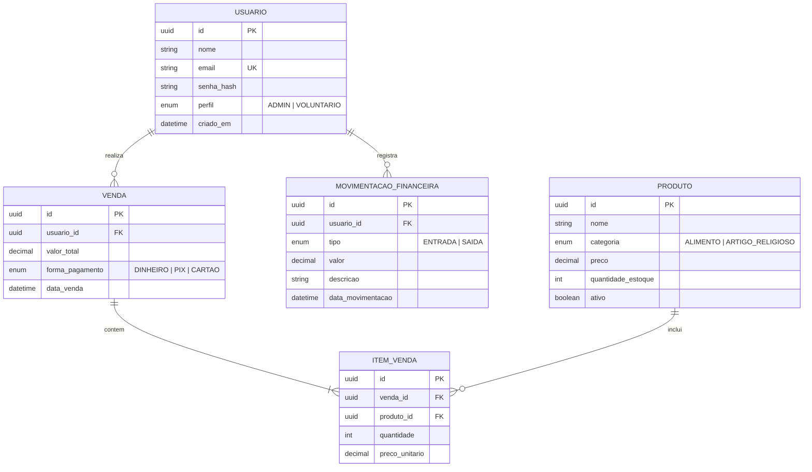

# AgnusGestao - Sistema de Gestão do Grupo de Oração Agnus Dei

Sistema de gerenciamento para controle de caixa, estoque e vendas do Grupo de Oração Agnus Dei, pertencente à Paróquia São Vicente Ferrer (Formiga - MG).

## 1. Tema e Propósito

O **AgnusGestao** é um sistema de gerenciamento destinado ao controle financeiro do grupo de oração, incluindo a gestão do catálogo e a venda de produtos (alimentos, bebidas, terços, camisetas e artigos religiosos) comercializados nos encontros, além do controle das entradas e saídas de recursos do caixa.

## 2. Perfis de Acesso e Permissões

- **ADMIN (Coordenador):** acesso completo ao sistema. Pode gerenciar voluntários, cadastrar e alterar produtos, registrar entradas e saídas financeiras e emitir relatórios.
- **VOLUNTARIO (Membro Servidor):** acesso restrito à consulta do catálogo de produtos e ao registro de vendas realizadas durante os encontros.

## 3. Entidades de Negócio

1. **Usuario:** cadastro de membros, voluntários e coordenadores, utilizado para autenticação JWT e controle de permissões.
2. **Produto:** cadastro dos itens comercializados nos encontros, divididos em alimentos e artigos religiosos.
3. **Venda:** registro das transações comerciais, incluindo valor total, voluntário responsável e forma de pagamento.
4. **MovimentacaoFinanceira:** controle do caixa do grupo, registrando entradas e despesas ou saídas, com descrição e data.

## 4. Diagrama de Entidade-Relacionamento (DER)

## 5. Semana 2 — Estruturação do Backend

### 5.1. Tecnologias utilizadas

- **Node.js e Express:** execução e estruturação do servidor.
- **PostgreSQL e Sequelize ORM:** banco de dados e mapeamento das entidades.
- **Docker e Docker Compose:** configuração do ambiente de execução.
- **dotenv:** gerenciamento das variáveis de ambiente.

### 5.2. Organização do projeto

O backend foi organizado em diretórios:

- `src/config/`: configuração do banco de dados.
- `src/models/`: modelos das entidades e seus relacionamentos.
- `src/controllers/`: diretório destinado aos controladores.
- `src/routes/`: organização das rotas da API.
- `src/middlewares/`: tratamento de erros.
- `src/app.js`: configuração e inicialização do servidor.

Também foram criados os arquivos de configuração do ambiente e do Docker.

### 5.3. Implementação dos modelos

Os modelos foram implementados com Sequelize ORM, definindo atributos, tipos de dados e restrições.

- **Usuario:** ID único (UUID), nome, e-mail único, hash da senha e perfil (`ADMIN` ou `VOLUNTARIO`).
- **Produto:** ID, nome, categoria, preço, quantidade em estoque e situação (ativo ou inativo).
- **Venda:** ID, usuário responsável, valor total, forma de pagamento e data da venda.
- **ItemVenda:** ID, venda associada, produto associado, quantidade e preço unitário.
- **MovimentacaoFinanceira:** ID, usuário responsável, tipo (`ENTRADA` ou `SAIDA`), valor, descrição e data da movimentação.

Os relacionamentos entre as entidades foram definidos em `src/models/index.js`.

### 5.4. API e execução

Foi configurada a aplicação Express, com uma rota inicial para verificar o funcionamento do servidor e um middleware global para tratamento de erros em JSON.

A API foi executada e testada localmente, com resposta confirmada no endereço `http://localhost:3000`.

### 5.5. Resultado da semana

Foi estruturado o backend, implementados os modelos e relacionamentos das entidades e preparados os arquivos de configuração do banco de dados e do Docker. O teste local também confirmou o funcionamento inicial da API, estabelecendo a base para as próximas etapas do projeto.

## Semana 3 — Autenticação, Controle de Acesso (RBAC) e Recuperação de Senha

Nesta etapa, foram implementados os mecanismos de segurança da API do backend **Agnus Gestão**:

* **Autenticação Segura (JWT):** Geração de tokens de acesso seguros para o usuário autenticado.
* **Criptografia de Senhas:** Utilização da biblioteca `bcryptjs` para hashing de senhas.
* **Perfis de Acesso (RBAC):** Controle de permissões baseado em níveis de acesso (`ADMIN` e `VOLUNTARIO`).
* **Recuperação de Senha por E-mail:** Fluxo completo com emissão de token temporário (`token_recuperacao` e `token_recuperacao_expira`) para redefinição de senha.
* **Ambiente Dockerizado:** Banco de dados PostgreSQL rodando em container Docker com sincronização e *seed* automático do usuário administrador inicial (`admin@agnus.com` / `123456`).

---
### Rotas de Autenticação

* **`POST /auth/login`**: Autentica o usuário e gera o Token JWT.
* **`POST /auth/forgot-password`**: Solicita a redefinição de senha e gera o token temporário.
* **`POST /auth/reset-password`**: Redefine a senha utilizando o token temporário.

---

### Testes via Postman

1. Importar o arquivo da collection (`.json`) no Postman.
2. Executar rota `POST /auth/login`. O token JWT será salvo automaticamente na variável `{{token}}` para autenticar as próximas requisições.